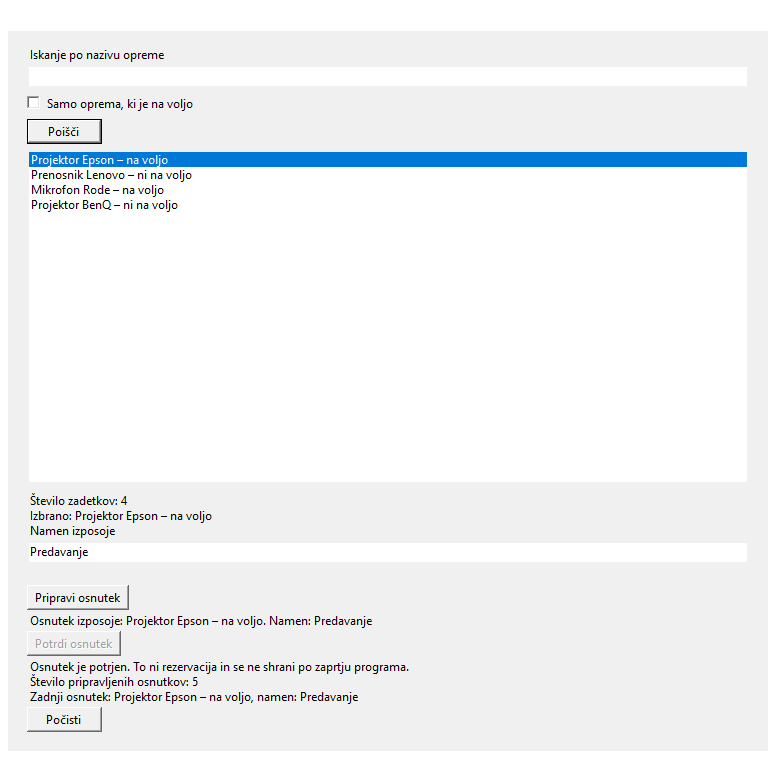
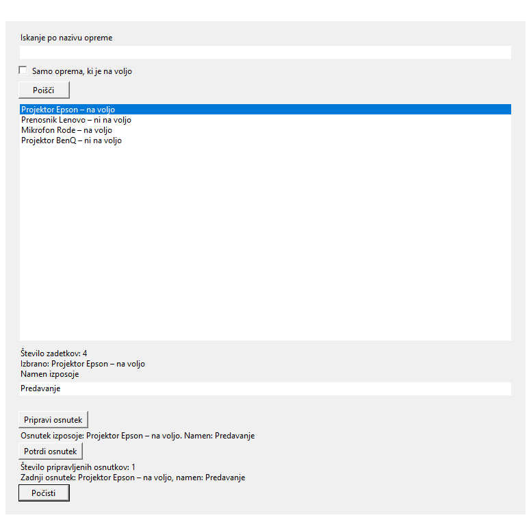
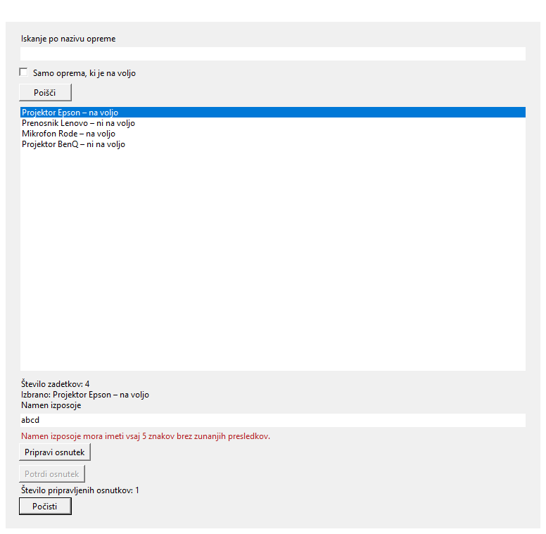
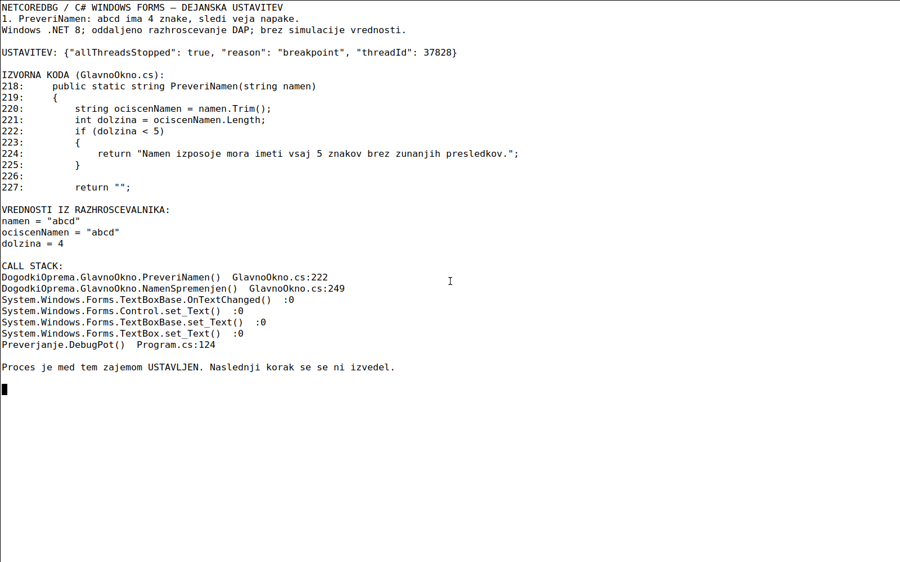
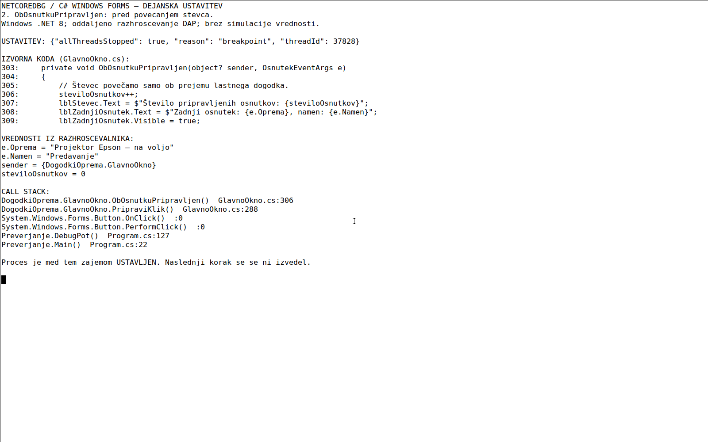
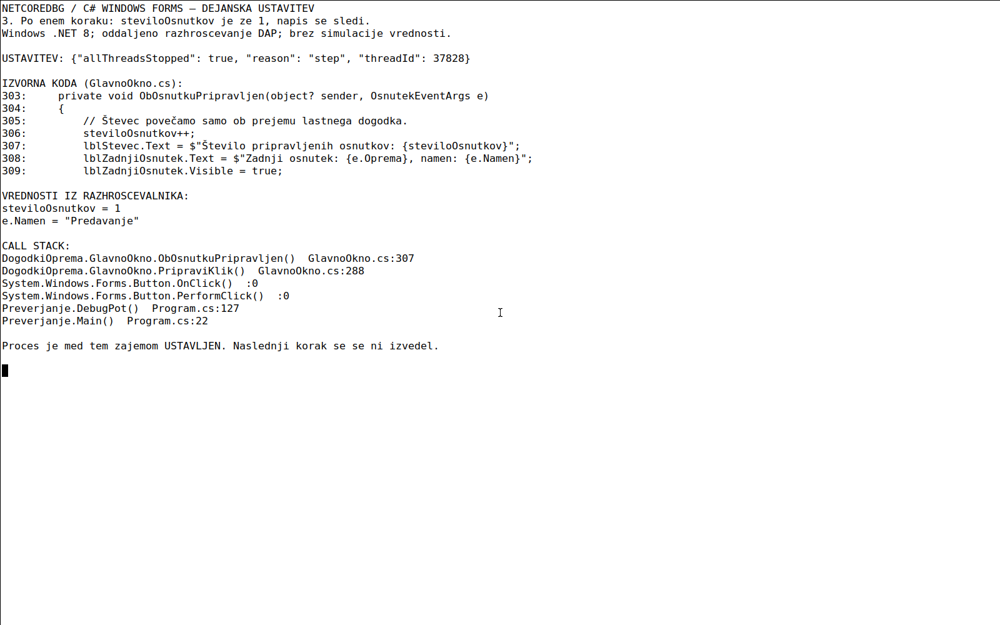

# Vaja 2 – C# Windows Forms

**Avtor:** Viktorij Krajnc.
**Izvedba:** C# / Windows Forms / .NET 8. Dopolnitev priloženega projekta.

## 1. Zagon

Na Windows odpremo `DogodkiOprema.csproj` v Visual Studiu z nameščeno podporo za razvoj namiznih aplikacij .NET. Ctrl+F5 zažene brez razhroščevanja, F5 z razhroščevalnikom. Iz nadrejene mape lahko uporabimo:

```powershell
dotnet build .\Vaja002\DogodkiOprema.csproj
dotnet run --project .\Vaja002\DogodkiOprema.csproj
```

Program ničesar ne shranjuje. Tudi potrjeni osnutek ne rezervira opreme in ne spreminja njene razpoložljivosti.

## 2. Začetni primer

- `Program.cs` pripravi aplikacijo in odpre `GlavnoOkno`.
- `GlavnoOkno.cs` ustvari gradnike in jih poveže z dogodki; prikazuje rezultate.
- `Katalog.cs` vsebuje štiri vzorčne kose in neodvisno iskalno pravilo.
- `.csproj` določa ciljno ogrodje .NET 8 Windows in Windows Forms.

| Dogodek | Obdelovalnik | Odziv |
|---|---|---|
| `btnPoisci.Click` | `PoisciKlik` | Osveži seznam. |
| `chkNaVoljo.CheckedChanged` | `FilterSpremenjen` | Osveži glede na filter. |
| `lstOprema.SelectedIndexChanged` | `IzborSpremenjen` | Izpiše izbrano opremo. |
| `txtNamen.TextChanged` | `NamenSpremenjen` | Preveri namen in skrije stara prikaza. |

Pot iskanja: Poišči → Click → PoisciKlik → OsveziSeznam → Katalog.Poisci → seznam rezultatov in oznaka števila zadetkov. `AcceptButton = btnPoisci` ohranja Enter za iskanje. Samo tipkanje seznama ne osveži; dodani obdelovalnik tipkanja v iskanje zgolj skrije zastarel povzetek.

`SelectedItem` je lahko `null` tudi med programskim praznjenjem seznama. Zato `IzborSpremenjen` takrat izpiše poziv in konča z `return`.

## 3. Dopolnitev

Prevzeti so Program, podatki in iskalna logika Kataloga ter nastavitve projekta. V Katalogu so zdaj tipi zapisani izrecno, logika pa je enaka. V oknu so dodani namen, napaka, gumb Pripravi osnutek, povzetek, Potrdi osnutek, oznaka potrditve, števec, zadnji osnutek in Počisti. Postavitev uporablja 17 vrstic TableLayoutPanel, seznam pa porabi preostali prostor. Gradniki imajo določene TabIndex in Name. Nov je `OsnutekEventArgs.cs`.

### Bolj običajen zapis C#

Pogoji so zapisani z običajnimi if/else in zavitimi oklepaji, tipi izrecno, lastnosti gradnikov pa vsaka v svoji vrstici. Besedila z vstavljenimi vrednostmi uporabljajo interpolacijo. Lasten dogodek, EventArgs, registracija in Invoke so obvezni deli naloge.

`PreveriNamen` uporabi `Trim()`, shrani dolžino in vrne napako pri manj kot 5 znakih, sicer prazen niz. `abcd` je napačen, `abcde` veljaven. Ista metoda se uporabi sproti v `NamenSpremenjen` in ob kliku v `PripraviKlik`. Sprememba namena, izbora, iskalnega besedila ali osvežitev seznama skrije stari povzetek in zadnji osnutek.

Ob pripravi se preverita izbor in namen. Ob napaki se pokaže opozorilo, fokus omogoči popravek in `return` prepreči uspešni dogodek. Ob uspehu nastane `OsnutekEventArgs` z besedilom izbrane vrstice ter očiščenim namenom.

### Lastni dogodek

1. Deklaracija: `public event EventHandler<OsnutekEventArgs>? OsnutekPripravljen`.
2. Registracija v konstruktorju, enkrat: `OsnutekPripravljen += ObOsnutkuPripravljen`.
3. Sprožitev po uspešnem preverjanju: `OsnutekPripravljen?.Invoke(this, podatki)`.
4. Obdelovalnik prejme `sender` (trenutno okno) ter `e.Oprema` in `e.Namen`. Samo tukaj poveča števec in iz prejetih podatkov pokaže zadnji osnutek.

Registracija, sprožitev in izvedba obdelovalnika so ločeni koraki. Neposreden klic metode za števec ne nadomesti dogodka. Vsak veljaven klik, tudi ponovljen z istimi podatki, sproži natanko en dogodek. Neveljaven klik ne sproži nobenega.

Počisti izprazni namen, odstrani izbor, napake in prikaza ter ponastavi števec na 0. Iskalnega pogoja in filtra ne spreminja. Uspešnega dogodka ne sproži.

### Potrditev osnutka

Gumb `btnPotrdi` je sprva onemogočen. Uspešna priprava ga omogoči. Klik sproži `PotrdiKlik`, ki pokaže »Osnutek je potrjen.« in opozorilo, da to ni rezervacija ali trajno shranjevanje, nato gumb onemogoči. Isti osnutek zato ni mogoče potrditi dvakrat. Potrditev ne sproži dogodka `OsnutekPripravljen` in ne poveča števca priprav.

Metoda `SkrijPovzetek` odstrani tudi oznako potrditve in onemogoči gumb. Uporablja se pri spremembi namena, izbora ali iskanja, osvežitvi seznama, filtru, novi pripravi in čiščenju. Nova veljavna priprava omogoči novo potrditev. Gre za dodaten prikaz zaključka postopka, ne za shranjevanje dejanske izposoje.

## 4. Preizkusi

Končna dopolnitev s potrditvijo je preverjena v pravem WinForms oknu na Windows z .NET 8.0.22 x64; gradnja za net8.0-windows je uspela. Dopolnitev je prestala 45 preverjanj: vseh 31 obstoječih in 14 novih. Rezultati so v `rezultati-preizkusov.json`; začetni preizkusi izhodišča so v `zacetni-preizkusi.json`. Preverjanja so avtomatizirana: preverjevalnik je uporabil prave gradnike, PerformClick, spremembe besedila, izbora in Paste.

### Začetni primer – 10 uspešnih / 0 neuspešnih

| Dejanje/vhod | Pričakovani rezultat | Dejanski rezultat | Uspešno/neuspešno |
|---|---|---|---|
| Zagon | 4 kosi in poziv za izbor. | 4 kosi in poziv za izbor. | Uspešno |
| projektor + Poišči | Dva projektorja. | Dva projektorja. | Uspešno |
|   PROJEKTOR   + Enter | Ista dva projektorja. | Ista dva projektorja. | Uspešno |
| Filter projektorjev | Projektor Epson. | Projektor Epson. | Uspešno |
| Prazen pogoj in filter | Epson in Rode. | Epson in Rode. | Uspešno |
| Brez filtra | 4 kosi. | 4 kosi. | Uspešno |
| kamera | Prazen seznam, Ni zadetkov. | Prazen seznam, Ni zadetkov. | Uspešno |
| Izbor vrstice | Oznaka izbrane opreme. | Oznaka izbrane opreme. | Uspešno |
| Iskanje po izboru | Izbor odstranjen. | Izbor odstranjen. | Uspešno |
| Večkrat Poišči | Ni podvojitev, 4 kosi. | Ni podvojitev, 4 kosi. | Uspešno |

### Dopolnitev – 31 uspešnih / 0 neuspešnih

| Dejanje/vhod | Pričakovani rezultat | Dejanski rezultat | Uspešno/neuspešno |
|---|---|---|---|
| Zagon | 4 kosi, števec 0, oba povzetka skrita. | 4 kosi, števec 0, oba povzetka skrita. | Uspešno |
| projektor + Poišči | Dva projektorja. | Dva projektorja. | Uspešno |
|   PROJEKTOR   + privzeto dejanje Enter | Ista dva projektorja; AcceptButton je Poišči. | Ista dva projektorja; AcceptButton je Poišči. | Uspešno |
| Filter pri projektorjih | Samo Projektor Epson. | Samo Projektor Epson. | Uspešno |
| Prazen pogoj + filter | Epson in Rode. | Epson in Rode. | Uspešno |
| Odstranitev filtra | Vsi 4 kosi. | Vsi 4 kosi. | Uspešno |
| kamera | Prazen seznam in Ni zadetkov. | Prazen seznam in Ni zadetkov. | Uspešno |
| Izbira vrstice | Oznaka pokaže izbrani kos. | Oznaka pokaže izbrani kos. | Uspešno |
| Novo iskanje po izboru | Izbor odstranjen, poziv k izboru. | Izbor odstranjen, poziv k izboru. | Uspešno |
| Trikrat isto iskanje | Še vedno 4 kosi brez podvojitev. | Še vedno 4 kosi brez podvojitev. | Uspešno |
| Tipkanje v iskanje brez klika | Seznam se še ne osveži. | Seznam se še ne osveži. | Uspešno |
| Brez izbrane opreme, veljaven namen | Opozorilo; brez osnutka in dogodka, števec ostane 0. | Opozorilo; brez osnutka in dogodka, števec ostane 0. | Uspešno |
| Namen "" | Napaka in brez uspešnega dogodka. | Napaka in brez uspešnega dogodka. | Uspešno |
| Namen "   " | Napaka in brez uspešnega dogodka. | Napaka in brez uspešnega dogodka. | Uspešno |
| Namen "abcd" | Napaka in brez uspešnega dogodka. | Napaka in brez uspešnega dogodka. | Uspešno |
| Namen "  abcd  " | Napaka in brez uspešnega dogodka. | Napaka in brez uspešnega dogodka. | Uspešno |
| Namen abcde | 5 znakov sprejetih, natanko en dogodek in števec +1. | 5 znakov sprejetih, natanko en dogodek in števec +1. | Uspešno |
|   Predavanje   | Trim v povzetku in podatkih; sender je okno. | Trim v povzetku in podatkih; sender je okno. | Uspešno |
| Lepljenje abcd, nato Predavanje | TextChanged pokaže napako in jo nato odstrani. | TextChanged pokaže napako in jo nato odstrani. | Uspešno |
| Počisti, dvakrat veljavno, nato napačno | Števec 0 → 1 → 2 → 2, samo dva nova dogodka. | Števec 0 → 1 → 2 → 2, samo dva nova dogodka. | Uspešno |
| Sprememba namena po uspehu | Skrije oba prikaza; števec enak. | Skrije oba prikaza; števec enak. | Uspešno |
| Sprememba izbora po uspehu | Skrije oba prikaza; števec enak. | Skrije oba prikaza; števec enak. | Uspešno |
| Novo iskanje po uspehu | Izbor odstranjen in prikaza skrita. | Izbor odstranjen in prikaza skrita. | Uspešno |
| Filter po uspehu | Seznam osvežen, izbor odstranjen in prikaza skrita. | Seznam osvežen, izbor odstranjen in prikaza skrita. | Uspešno |
| Počisti po napaki | Namen in izbor prazna, napaka prazna, povzetka skrita, števec0; brez dogodka. | Namen in izbor prazna, napaka prazna, povzetka skrita, števec0; brez dogodka. | Uspešno |
| Veljavno po čiščenju | Števec1 in en dogodek. | Števec1 in en dogodek. | Uspešno |
| Tudi kos, ki ni na voljo | Dovoljen osnutek, ne rezervacija. | Dovoljen osnutek, ne rezervacija. | Uspešno |
| Programski prehod Tab | Doseže iskanje, filter, Poišči, seznam, namen, Pripravi in Počisti. | Doseže iskanje, filter, Poišči, seznam, namen, Pripravi in Počisti. | Uspešno |
| Najmanjše in običajno okno | Gradniki so znotraj odjemalskega območja brez prekrivanja. | Gradniki so znotraj odjemalskega območja brez prekrivanja. | Uspešno |
| Zelo dolg namen | Veljaven namen ostane berljiv; brez prekrivanja vrstic. | Veljaven namen ostane berljiv; brez prekrivanja vrstic. | Uspešno |
| Novo okno po zaprtju | Števec0, namen prazen in povzetek skrit. | Števec0, namen prazen in povzetek skrit. | Uspešno |

### Dodatnih 14 preverjanj potrditve

Uspešno so bili preverjeni: začetna onemogočena potrditev po čiščenju, klik brez osnutka, neveljaven namen, veljavna priprava in potrditev brez spremembe števca ali dogodka, ponovni klik, razveljavitev po spremembi namena, izbora, tipkanju iskanja, kliku Poišči in spremembi filtra, čiščenje po potrditvi, nova priprava po potrditvi, dostop do gumba s Tab ter postavitev potrjenega osnutka v najmanjšem in večjem oknu. Pri vseh primerih sta pričakovano in dejansko stanje skladna; podrobni vhodi in rezultati so v JSON-u.

### Dejanski izrisi na Windows







To so izrisi gradnikov z `DrawToBitmap`, ne fotografije aktivnega uporabniškega namizja in ne dokaz ustavljenega izvajanja.

## 5. Razhroščevanje – dejanske ustavitve in slike

Dokazi so zajeti nad pravim Windows procesom. Slike in številke vrstic veljajo za priloženo kodo z interpolacijo. Uporabljen je Samsung NetCoreDbg 3.2.0-1092 prek protokola DAP, z izoliranim prenosnim .NET 8.0.33 x64. Sistemskih nastavitev .NET nismo spreminjali.

**Slike prikazujejo dejanski terminalski odjemalec razhroščevalnika na Linuxu, povezan prek SSH z ustavljenim procesom na Windows. Niso slike Visual Studia, makete ali ročno izmišljene vrednosti.** Program je bil med vsakim zajemom res ustavljen. Vrednosti, razlog ustavitve in sklad klicev so pridobljeni iz njegovih odgovorov DAP. Dejanji v pravih WinForms gradnikih je samodejno sprožil ločen preverjevalni program.

### Slika 1: preverjanje novega namena



- Vhod: preverjevalnik v pravo polje `txtNamen` nastavi `abcd`; sproži se `TextChanged`, nato `NamenSpremenjen` in `PreveriNamen`.
- Ustavitev: `GlavnoOkno.cs:222`, tik pred preverjanjem `if (dolzina < 5)`.
- Opazovane vrednosti: `namen = "abcd"`, `ociscenNamen = "abcd"`, `dolzina = 4`. V skladu klicev je viden `NamenSpremenjen`.
- Naslednji korak preide v vejo napake; metoda vrne opozorilo in obdelovalnik ga prikaže. Tak vnos ne omogoča uspešne priprave osnutka.
- Ponovljen robni preizkus z `abcde` je v razhroščevalniku pokazal dolžino 5; ta vnos je veljaven. Zunanje presledke odstrani `Trim()`, notranji presledki pa ostanejo del besedila.

### Slika 2: obdelovalnik lastnega dogodka



- Vhod: izbran Projektor Epson in namen `  Predavanje  `; preverjevalnik sproži pravi gumb z `PerformClick()`.
- Ustavitev: `GlavnoOkno.cs:306`, pred `steviloOsnutkov++` v `ObOsnutkuPripravljen`.
- Podatki: `sender` je `GlavnoOkno`, `e.Oprema = "Projektor Epson – na voljo"`, `e.Namen = "Predavanje"`, `steviloOsnutkov = 0`.
- Sklad klicev vsebuje `ObOsnutkuPripravljen → PripraviKlik → Button.OnClick → Button.PerformClick → Preverjanje.DebugPot`. Registracija obdelovalnika je v konstruktorju na vrstici 211, sprožitev dogodka pa na vrstici 288.
- Naslednji korak izvede povečanje števca. Posodobitev napisa je šele naslednja vrstica, zato številska spremenljivka in napis med korakanjem nista nujno že usklajena.

### Dodatna slika: po koraku je števec 1



Po ukazu `next` (enakovredno koraku čez vrstico oziroma F10) je izvajanje ustavljeno na vrstici 307 in `steviloOsnutkov = 1`. To potrdi spremembo 0 → 1. Naslednji korak posodobi besedilo `lblStevec`. Podatki so tudi v `razhroscevanje.json`.

### Postopek razhroščevanja v Visual Studiu

1. Odpri `DogodkiOprema.csproj`, postavi breakpoint na `if (dolzina < 5)` in zaženi F5. Izberi opremo ter vnesi `abcd`. V Locals/Watch pokaži navedene spremenljivke, v Call Stack pa klicatelja.
2. Izključi prvo točko in drugo postavi na `steviloOsnutkov++`. Po čiščenju izberi Epson, vnesi veljaven namen in klikni Pripravi osnutek. Pokaži `sender`, `e.Oprema`, `e.Namen` in števec. S F10 pokaži spremembo 0 → 1.

## 6. Viri in omejitve

Projekt temelji na priloženem šolskem začetnem primeru in navodilih za vajo 2. Pri pripravi dokumentacije, dela kode in preverjanj je bila uporabljena pomoč AI. Ročno upravljanje prek fizične tipkovnice ni bilo predmet teh avtomatiziranih preverjanj.

- Microsoft Learn, dogodki s podatki: https://learn.microsoft.com/en-us/dotnet/standard/events/how-to-raise-and-consume-events#raise-an-event-with-data
